# DouyinSignServerRust

> **重要免责声明 / Educational Purpose Only**
>
> 本项目基于 **MIT 协议**开源，**仅限用于学习与技术研究目的**（学习现代 Rust 2024、ECS 架构 `bevy_ecs`、纯 Rust JS 引擎 `boa_engine` 与 `axum` 异步 Web 服务开发）。
> 严禁将本项目用于任何商业用途、违规抓取或违反第三方平台服务条款的行为。使用本项目所产生的一切后果由使用者自行承担。

将原有 C# (.NET 8 + ClearScript V8) 开发的 `DouyinSignServer` 完整迁移重构为**现代 Rust (Edition 2024)** + **ECS（Entity-Component-System）架构**的信令签名服务器，并内置零外部依赖的**完整 Web GUI 测试与 ECS 监控控制台**。

---

## 核心特性

- **纯 Rust 现代技术栈**：`Rust 2024` + `tokio` + `axum 0.8` + `bevy_ecs 0.15` + `boa_engine 0.20`
- **真正的 ECS 架构**：使用 `bevy_ecs` 驱动整个请求生命周期，每个签名请求以 Entity 进入 World，依次流经 8 个确定性 System 管线阶段
- **常驻 JS VM Worker 池**：使用纯 Rust 的 `boa_engine` 加载 `scripts/webmssdk.vm.js`，无需 V8/C++ 原生动态库，跨平台开箱即用；相比原 C# 每次请求重建 `V8ScriptEngine`，Rust 版本在启动时预热常驻 VM 池，大幅降低签名延迟
- **100% 兼容原 C# 接口协议**：
  - `POST /Douyin/SignWss`（兼容 PascalCase / camelCase / snake_case 请求体，返回标准 `ApiResultModel`）
  - `POST /Kwai/UidToEid`（完整移植原 `KwaiController` 逻辑）
- **内置完整 Web GUI 测试台（`GET /`）**：
  - 抖音 WSS 签名交互式测试 + cURL / PowerShell / Fetch 代码生成
  - 并发压测工具（支持自定义总请求数与并发度，实时计算 QPS 与最小/平均/最大延迟）
  - 快手 `UidToEid` 测试页面
  - **ECS World 实时监控面板**：可视化 8 阶段 System 管线、常驻 JS Worker Entity、ServiceNode Entity 与动态 `ApiKeyRegistry` 管理
  - 实时请求日志（支持按 RoomId / IP / 状态搜索过滤）

---

## 原 C# 版本 vs 现代 Rust ECS 版本对比

| 维度 | 原 C# (`DouyinSignServer`) | 新 Rust (`DouyinSignServerRust`) |
| --- | --- | --- |
| 运行时 | .NET 8 (`net8.0-windows` 绑定 Windows) | 原生编译单文件二进制（跨平台 Windows/Linux/macOS） |
| 架构模式 | 传统 ASP.NET Core MVC Controller | `bevy_ecs` Entity-Component-System 管线架构 |
| JS 签名引擎 | `ClearScript.V8`（每次请求新建并销毁 V8 实例） | 纯 Rust `boa_engine` 常驻多线程 VM 池（启动预热一次） |
| Web 框架 | ASP.NET Core + Swagger | `axum 0.8` + `tokio` + 内置现代化 GUI 控制台 |
| API Key 管理 | 硬编码在 `DouyinController.cs` | ECS `ApiKeyRegistry` Resource（支持环境变量与 GUI 动态增删） |
| 可观测性 | 仅本地文本日志 | 实时 ECS World 快照 API + GUI 指标卡片 + 实时日志 + 可选文件日志 |

---

## ECS 架构设计

本项目使用 `bevy_ecs` 构建了一个独立运行在后台线程上的 `World` 与 `Schedule`，通过事件驱动唤醒机制（空闲时低 CPU 占用，请求到达瞬间批处理执行）与异步 `axum` 网关解耦：

```mermaid
flowchart LR
    HTTP["Axum HTTP Request"] -->|"EcsCommand"| S1["1. ingest_commands_system\n生成 Request Entity"]
    S1 --> S2["2. validate_auth_system\n校验 ApiKeyRegistry"]
    S2 --> S3["3. validate_douyin_payload_system\n参数校验 & 计算 MD5 Stub"]
    S3 --> S4["4. execute_douyin_sign_system\nBoa JS VM 池执行 frontierSign"]
    S4 --> S5["5. dispatch_response_and_log_system\n回传 HTTP & 写入指标/日志"]
    S5 --> S6["6. sync_worker_entities_system\n同步 JsWorkerEntity 状态"]
    S6 --> S7["7. cleanup_completed_entities_system\n回收已完成 Entity"]
    S7 --> S8["8. serve_snapshots_system\n导出 ECS World 快照"]
```



### 核心 ECS 要素

- **Entities（实体）**：
  - 瞬态请求实体（Request Entity）：每个 `/Douyin/SignWss` 请求都会在 World 中生成一个 Entity，携带请求数据流经各个 System，响应完成后由清理 System 自动 `despawn`。
  - 常驻服务实体（`ServiceNode`）：描述当前暴露的 HTTP 服务节点。
  - 常驻引擎实体（`JsWorkerEntity`）：映射后台每一个 Boa JS VM 工作线程的实时状态与任务计数。
- **Components（组件）**：
  - `RequestMeta`、`ApiKeyAuth`、`DouyinSignPayload`、`ValidationState`、`ComputedStub`、`SignResult`、`ResponseChannel`、`CompletedTag`
- **Resources（全局资源）**：
  - `ServerConfig`、`ApiKeyRegistry`、`SignEngineResource`、`MetricsResource`、`RequestLogBuffer`、`CommandBatch`、`PendingSnapshots`

---

## 快速开始

### 1. 环境要求

- Rust 1.85+（支持 Edition 2024，推荐使用 `rustup` 安装最新稳定版）

### 2. 运行服务

```bash
# 开发模式运行
cargo run

# 推荐：Release 模式运行（Boa JS 签名性能大幅提升）
cargo run --release
```

启动后访问内置 GUI 测试与 ECS 监控控制台：

- **GUI 控制台**：`http://127.0.0.1:5289/`
- **健康检查**：`GET http://127.0.0.1:5289/api/health`
- **ECS 快照**：`GET http://127.0.0.1:5289/api/ecs/snapshot`

### 3. 配置文件（`config.toml`）与环境变量

项目采用 Rust 标准的 TOML 配置文件管理所有服务端与快手相关参数（**源码中不包含任何硬编码密钥、IP 或 Token**），配置加载优先级为：**环境变量 > `config.toml` > 内置默认值**。

首次使用可复制模板文件并按需修改：

```bash
cp config.example.toml config.toml
```

> `config.toml` 已加入 `.gitignore`，避免本地密钥和 Token 被误提交至开源仓库。可通过 `SIGN_CONFIG_PATH` 指定自定义配置文件路径。

| 环境变量 | 对应 `config.toml` 字段 | 默认值 | 说明 |
| --- | --- | --- | --- |
| `SIGN_CONFIG_PATH` | - | `config.toml` | 自定义 TOML 配置文件路径 |
| `SIGN_SERVER_HOST` | `[server].host` | `0.0.0.0` | 监听地址 |
| `SIGN_SERVER_PORT` | `[server].port` | `5289` | 监听端口（与原 C# 默认端口一致） |
| `SIGN_SCRIPT_PATH` | `[server].script_path` | `scripts/webmssdk.vm.js` | 签名脚本路径 |
| `JS_WORKER_COUNT` | `[server].js_worker_count` | `2` | 常驻 Boa JS VM 工作线程数量 |
| `SIGN_API_KEYS` | `[auth].api_keys` | `demo-apikey-learning-only,...` | 逗号分隔的初始合法 API Key 列表 |
| `SIGN_LOG_TO_FILE` | `[logging].log_to_file` | `true` | 是否写入每日日志文件 `logs/logs_YYYYMMDD.txt` |
| `SIGN_LOG_DIR` | `[logging].log_dir` | `logs` | 日志输出目录 |
| `SIMULATE_TEST_KEY_BUSY` | `[auth].simulate_test_key_busy` | `false` | 是否模拟原 C# 测试 Key 的随机繁忙拦截 |
| `KWAI_SIGN_ENDPOINT` | `[kwai].sign_endpoint` | 空 | 快手签名服务地址 |
| `KWAI_API_KEY` | `[kwai].api_key` | 空 | 快手签名服务 ApiKey |
| `KWAI_DEFAULT_TOKEN` | `[kwai].default_token` | 空 | 快手接口默认 Cookie Token |

---

## API 接口说明

### 1. 抖音 WSS 签名：`POST /Douyin/SignWss`

**请求示例：**

```json
{
  "ApiKey": "demo-apikey-learning-only",
  "RoomId": "7415791943831046921",
  "UserUniqueId": "7410618736569206322",
  "BrowserName": "Mozilla",
  "BrowserVersion": "5.0 (Windows NT 10.0; Win64; x64) AppleWebKit/537.36 (KHTML, like Gecko) Chrome/126.0.0.0 Safari/537.36"
}
```

**响应示例：**

```json
{
  "Code": 0,
  "Msg": null,
  "Data": {
    "WssUrl": "wss://webcast5-ws-web-lf.douyin.com/webcast/im/push/v2/?...&signature=...",
    "Signature": "fsRYL8aP68R54t5b",
    "StubMd5": "..."
  }
}
```

### 2. 快手 UID 转 EID：`POST /Kwai/UidToEid`

```json
{
  "UserId": "732982050",
  "LiveStreamId": "your_live_stream_id",
  "Token": "optional_cookie_token"
}
```

### 3. 直播间消息反馈与 Protobuf 联调接口

- `POST /api/live/resolve` — 传入 `{"live_url": "https://live.douyin.com/房间号"}`，解析 `room_id`、主播名、房间标题与 `ttwid`
- `GET /api/live/stream?live_url=...&api_key=...` — SSE 实时消息流：自动解析直播间 -> 调用 ECS 管线签名 -> 建立抖音 WSS 连接 -> Gzip 解压 & `prost` Protobuf 解码 -> 实时反馈弹幕、礼物、进房、点赞、关注、人数与控制消息
- `POST /api/proto/selftest` — 离线验证 `proto/douyin_webcast.proto` 编码 -> Gzip -> 解码闭环

### 4. 管理与监控接口

- `GET /api/health` — 服务与引擎健康状态
- `GET /api/ecs/snapshot` — 获取完整的 ECS World 实时快照
- `POST /api/keys` — 动态添加 API Key（`{"api_key": "..."}`）
- `DELETE /api/keys` — 动态移除 API Key（`{"api_key": "..."}`）
- `POST /api/config/busy-simulation` — 动态开关测试 Key 繁忙限流模拟

---

## 项目目录结构

```text
DouyinSignServerRust/
├── Cargo.toml
├── build.rs                    # 编译期通过 prost-build + protoc-bin-vendored 自动生成 Rust Protobuf 代码
├── config.example.toml         # 配置文件模板（复制为 config.toml 使用）
├── LICENSE                     # MIT 开源协议（含学习目的特别声明）
├── README.md
├── proto/
│   └── douyin_webcast.proto    # 抖音 Webcast IM Push v2 原始 Protobuf 定义文件
├── scripts/
│   └── webmssdk.vm.js          # 浏览器环境补丁与签名脚本
├── static/
│   └── index.html              # 完整内嵌 Web GUI 测试、直播消息反馈与 ECS 监控台
└── src/
    ├── main.rs                 # 启动入口与 Axum 服务装配
    ├── config.rs               # TOML + 环境变量配置加载（ServerConfig Resource）
    ├── models.rs               # 兼容原 C# 的请求/响应 DTO
    ├── engine.rs               # Boa JS VM 常驻工作线程池与 MD5/WSS 拼装
    ├── proto.rs                # Protobuf 生成代码挂载、Gzip 解压与弹幕/礼物消息解码器
    ├── live.rs                 # 直播间地址解析、WSS 握手、心跳/ACK 与 SSE 实时反馈
    ├── kwai.rs                 # 快手 UidToEid 异步客户端
    ├── ecs/
    │   ├── mod.rs              # EcsHandle 与 bevy_ecs World/Schedule 运行时
    │   ├── components.rs       # ECS Components 定义
    │   ├── resources.rs        # ECS Resources 与 Snapshot 定义
    │   └── systems.rs          # 8 阶段确定性 ECS Systems 管线
    └── web/
        ├── mod.rs              # Axum 路由与 CORS 中间件
        └── handlers.rs         # HTTP / SSE 处理器与 GUI 页面托管
```

---

## 开源协议

本项目采用 **MIT License** 开源，并在 [LICENSE](./LICENSE) 中明确标注了**仅限学习与技术研究目的（For Educational & Learning Purposes Only）**。
